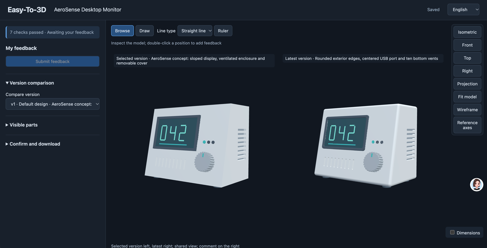
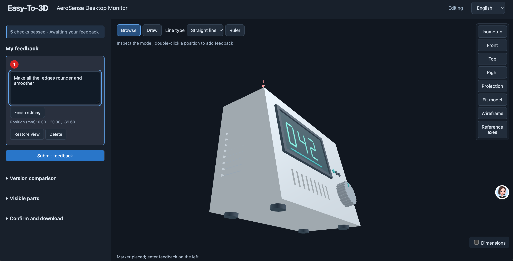
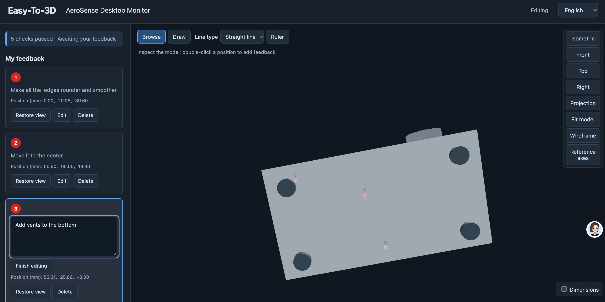

# Easy-To-3D

**Let your agent revise 3D models. See what changed and keep every version.**

[中文](README.zh-CN.md) · [Quick start](docs/quickstart.md) · [Compatibility](docs/compatibility.md) · [Report a problem](https://github.com/gyf2026/Easy-To-3D/issues)

A local workbench for mechanical design, 3D model review, drawing preparation and 3D printing. Your AI agent writes FreeCAD or Blender scripts; you inspect the result in a browser, mark where to change it, and compare revisions from the same viewpoint.

**Alpha · Python 3.10+ · Apache-2.0**. FreeCAD is the primary mechanical CAD path; Blender supports mesh workflows. These applications are installed separately. build123d is an experimental evaluation, not a supported product backend.


*Real FreeCAD concept model and English viewer: original on the left, revised on the right. This review cycle rounded the exterior edges, centered the rear USB port and added bottom vents. Manufacturing suitability has not been validated.*

<details>
<summary>See how the feedback was recorded</summary>


*Point to a location and describe the change.*


*The bottom-vent request shown here is on the original version, before modification. Submit feedback, then send the continuation instruction to your Agent.*

</details>

## What you can do

- **Point to the change.** Rotate, zoom and annotate a model with points or lines. Each comment retains its version, location and camera state.
- **Review the result.** Inspect old and new versions side by side with a shared view. Submission, Agent replies and your confirmation are separate records.
- **Keep your work.** Store requirements, source files, scripts, variants and immutable versions in a separate local project folder. Export and verify backups.
- **Prepare delivery.** Produce STL files and drawings through supported workflows. Printing suitability and patent-drawing requirements still need review; experimental section/exploded outputs are not a compliance guarantee.

## Start with your Agent

Clone this repository, then install in an isolated Python environment:

```sh
git clone https://github.com/gyf2026/Easy-To-3D.git
cd Easy-To-3D
python -m venv .venv
# macOS/Linux: source .venv/bin/activate
# Windows PowerShell: .venv\Scripts\Activate.ps1
python -m pip install .
```

Load [`skills/structural-design`](skills/structural-design/SKILL.md) using your client's skill mechanism. Give it the repository path and the Python environment above. The client needs local file/command access and visual inspection tools. This project supplies a Skill, CLI and viewer; the AI model comes from your client.

> Load this project's structural-design Skill. Check the available tools and use a separate project folder. Help me design a small mechanical bracket, confirm its dimensions with me, then create a first version using FreeCAD and open the viewer. After I submit annotations and send you the continuation instruction, revise that exact version, preserve the old one, and show both versions from the same view. Ask before installing software or using paid external services.

See the [step-by-step guide](docs/quickstart.md) for a concrete bracket exercise, requirements and where to install [FreeCAD](https://www.freecad.org/downloads.php) or [Blender](https://www.blender.org/download/). Neither application is bundled. No Node/npm is needed to use the packaged viewer.

**The viewer does not automatically wake your Agent.** Submit your comments, then copy its continuation instruction into the Agent conversation. A submitted checkmark means “submitted”, not “fixed” or “accepted”.

## Scope and compatibility

macOS and Windows have recorded checks; Linux and other browsers are not yet verified. WorkBuddy and Doubao usage has been confirmed by the project owner; exact client/model versions and every capability have not been independently certified. Codex has been used in development. See the [evidence scope and limitations](docs/compatibility.md).

Static GLB and binary STL can be imported with explicit units and up-axis. Imported meshes do not recover CAD feature history. The core and bundled viewer run locally without telemetry; your Agent client and any external services have their own data handling.

## Documentation and contributions

- [Agent workflow](docs/user-workflow.md) · [Detailed CLI workflow (中文)](docs/cli-workflow.zh-CN.md)
- [Delivery and printing](docs/agent-delivery.md) · [External model import](docs/external-models.md)
- [FreeCAD examples](backend-examples/freecad/) · [Blender examples](backend-examples/blender/)
- [Contributing](CONTRIBUTING.md) · [Security](SECURITY.md) · [License and bundled dependencies](LICENSE-STATUS.md)
- [Alpha release notes](docs/releases/v0.1.0a1.md)

Public CI checks package build, installation and CLI startup. Full functional tests and raw validation evidence are currently maintained separately and are not included in this repository. See the compatibility matrix rather than interpreting a green CI badge as complete functional validation.
