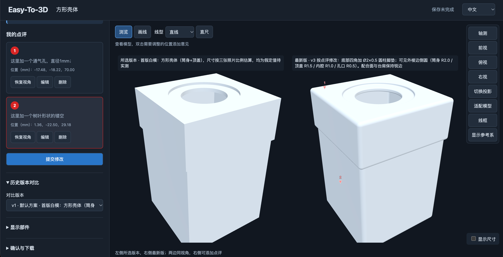
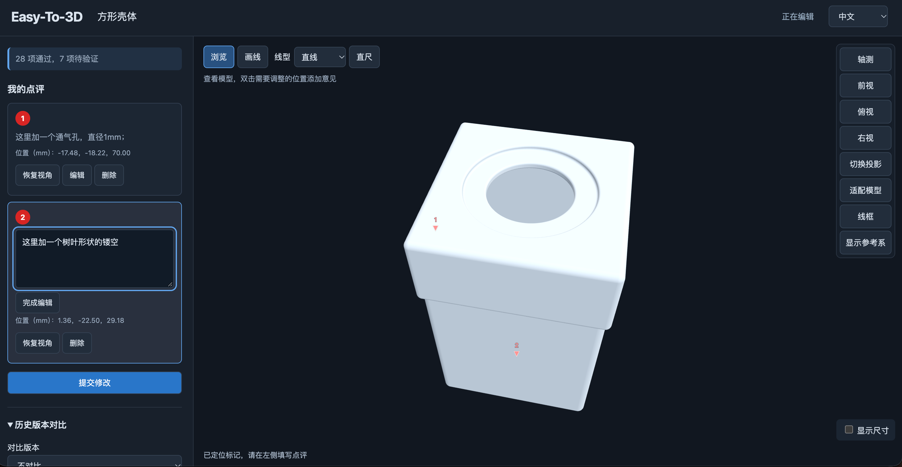

# Easy-To-3D

**让 Agent 改模型，让每轮修改都看得清、找得回。**

[English](README.md) · [开始使用](docs/quickstart.md) · [支持矩阵](docs/compatibility.md) · [反馈问题](https://github.com/gyf2026/Easy-To-3D/issues)

面向个人的本地三维设计与评审工作台：生成机械结构视图、迭代模型、制作专利申请所需附图，以及准备 3D 打印文件。Agent 自由编写 FreeCAD 或 Blender 脚本，你在浏览器里旋转查看、标记和点评，再用同一视角比较修改前后。

**Alpha · Python 3.10+ · Apache-2.0**。机械结构优先 FreeCAD，网格流程可用 Blender；按需要单独安装。build123d 目前仅作实验评估，不是正式支持的产品后端。


*中文查看器：左侧为所选的首版白模，右侧为按点评修改后的最新版。本版在底部四角增加 Ø2×0.5 圆柱脚垫，并对可见外棱边做侧倒圆（筒身 R2.0 / 顶盖 R1.5 / 内腔 R1.0 / 孔口 R0.5），配合面与台肩保持锐边。模型尺寸按照片比例估算，均为假定值，尚未实测。*

<details>
<summary>查看点评过程截图</summary>


*在模型上标记位置并描述修改要求，每条点评保留编号、位置坐标和视角。提交点评后，将继续修改指令发回 Agent。*

</details>

## 你可以做什么

- **指明哪里需要修改**：在模型上添加点、线和文字点评，保留对应版本、位置和完整视角。
- **看清改动是否正确**：新旧版本同视角并排查看。意见提交、Agent 回复和用户确认分别记录。
- **保留每轮成果**：独立项目文件夹保存需求、原生文件、脚本、变体和不可变版本，可以备份并校验。
- **准备交付文件**：按工作流导出 STL 和附图。打印适用性和专利附图要求仍需检查；剖视、爆炸图属于实验输出。

## 从一句话开始

先获取代码，在独立 Python 环境安装：

```sh
git clone https://github.com/gyf2026/Easy-To-3D.git
cd Easy-To-3D
python -m venv .venv
# macOS/Linux: source .venv/bin/activate
# Windows PowerShell: .venv\Scripts\Activate.ps1
python -m pip install .
```

让客户端按自身方式加载 [`structural-design` Skill](skills/structural-design/SKILL.md)，告诉它仓库位置和上述 Python 环境，然后发送：

> 请加载这个项目的 structural-design Skill，检查本次会话的识图、本地文件和命令执行能力。使用独立项目文件夹，帮我设计一个小型机械支架，先和我确认尺寸，再用 FreeCAD 建模并打开查看器。我提交点评并把继续修改指令发给你后，请读取对应版本的点评，保留原版，完成修改并打开同视角版本对比。安装软件或使用付费外部服务前先征求我的同意。

详见[首次体验指南](docs/quickstart.md)。[FreeCAD](https://www.freecad.org/downloads.php) 与 [Blender](https://www.blender.org/download/) 不随项目分发，不必同时安装。使用预构建查看器无需 Node/npm。项目本身不提供大模型，使用你客户端已接入的模型和工具。

**网页提交点评后，需要把继续修改指令发回 Agent；不会自动唤醒客户端。** 绿色勾表示意见已提交，不代表已修改或已验收。

## 支持范围

已有 macOS、Windows 验证记录；Linux 和其他浏览器仍待验证。项目所有者已确认 WorkBuddy、豆包可以正常使用，具体客户端/模型版本及逐项能力尚未完整归档；Codex 用于开发会话。详见[支持矩阵](docs/compatibility.md)，不推定所有环境都已通过。

可导入显式声明单位和上轴的静态 GLB、二进制 STL；导入网格不会还原 CAD 参数历史。核心和查看器本地运行，无遥测；宿主 Agent 和外部服务的数据处理范围由各自决定。

## 文档与贡献

[Agent 引导流程](docs/user-workflow.md) · [完整 CLI 工作流](docs/cli-workflow.zh-CN.md) · [保存与打印](docs/agent-delivery.md) · [外部模型](docs/external-models.md) · [FreeCAD 示例](backend-examples/freecad/) · [参与贡献](CONTRIBUTING.md) · [安全反馈](SECURITY.md) · [许可清单](LICENSE-STATUS.md) · [Alpha 发行说明](docs/releases/v0.1.0a2.md)

公开 CI 验证构建、安装及 CLI 启动。完整功能测试与原始验证材料目前单独维护，不随仓库分发；CI 通过不等于所有建模和交互流程均已验收。
